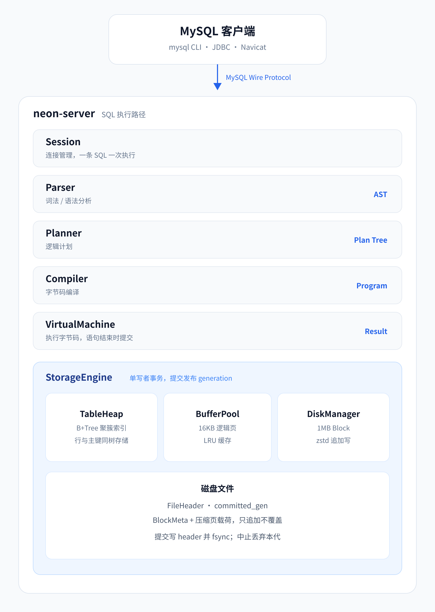

# PopoDB

[](https://en.cppreference.com/w/cpp/23)
[](LICENSE)

PopoDB 是一个使用 C++23 编写的关系型数据库。它提供 MySQL Wire Protocol
兼容服务、MVCC 事务、WAL/ARIES 恢复、B+Tree 存储和一套面向 OLTP/OLAP
查询的 SQL 执行引擎。

> 项目仍处于开发阶段，适合学习数据库实现、功能验证与性能实验，暂不建议用于生产数据。

## 核心能力

- MySQL Protocol v10，可使用 `mysql` CLI、JDBC 等标准客户端连接。
- `SELECT`、DML、DDL、视图、CTE、子查询、集合操作、窗口函数和常用标量/聚合函数。
- INNER/LEFT/RIGHT/FULL JOIN、Hash Join、谓词下推和子查询缓存。
- TPC-H Q1–Q22、RF1/RF2，以及 MySQL/PostgreSQL/DuckDB 常见 interval 写法。
- 行级 MVCC，支持 READ UNCOMMITTED、READ COMMITTED、REPEATABLE READ 和 SERIALIZABLE。
- WAL、崩溃恢复、Buffer Pool、聚簇主键和二级索引。
- `caching_sha2_password`、`mysql_native_password`、`sha256_password`，以及用户、主机和权限管理。
- 项目代码统一以 C++23 `std::expected`（`popo::base::Result<T>`）传递可恢复错误；第三方依赖不受此限制。

## 架构

```text
MySQL Client
    │
    ▼
Protocol / Authentication / Session
    │
    ▼
Lexer → Parser → Planner
                    │
          ┌─────────┴─────────┐
          ▼                   ▼
    Bytecode Compiler    Generic Executor
          │                   │
          └─────────┬─────────┘
                    ▼
             MVCC / Catalog
                    ▼
      Buffer Pool / B+Tree / WAL / Disk
```



## 构建

当前实现面向 Linux，并使用 `io_uring`。需要：

- 支持 C++23 的 GCC 或 Clang
- CMake 3.20+
- liburing、jemalloc、OpenSSL、zstd 和 pthread
- MySQL/MariaDB 客户端与开发库（仅客户端连接和相关测试需要）

以 Debian/Ubuntu 为例：

```bash
sudo apt install build-essential cmake liburing-dev libjemalloc-dev \
  libssl-dev libzstd-dev default-mysql-client libmariadb-dev

git clone https://github.com/fansehep/neon.git
cd neon
cmake -S . -B build -DCMAKE_BUILD_TYPE=Release
cmake --build build -j"$(nproc)"
```

## 启动与连接

仓库内的默认配置位于 `deploy/popodb.cnf`：

```bash
./build/src/popodb-server
mysql -h 127.0.0.1 -P 3307 -u root
```

指定配置文件或覆盖端口：

```bash
./build/src/popodb-server --defaults-file=/etc/popodb/popodb.cnf
./build/src/popodb-server 13306
```

也可以通过环境变量覆盖初始认证配置：

```bash
POPO_PASSWORD=secret POPO_AUTH_PLUGIN=caching_sha2_password \
  ./build/src/popodb-server
```

`deploy/popodb.service` 提供 systemd 示例，`deploy/init.sql` 提供用户与授权示例。

## SQL 示例

```sql
CREATE TABLE users (
    id BIGINT PRIMARY KEY,
    name VARCHAR(255) NOT NULL,
    age INT,
    created_at DATE
);

INSERT INTO users VALUES
    (1, 'Alice', 25, DATE '2026-01-01'),
    (2, 'Bob',   30, DATE '2026-01-02');

CREATE INDEX idx_users_age ON users(age);

SELECT name, age
FROM users
WHERE age >= 25
ORDER BY age DESC
LIMIT 10;

BEGIN;
UPDATE users SET age = age + 1 WHERE id = 1;
COMMIT;
```

用户与权限：

```sql
CREATE USER 'app'@'%' IDENTIFIED BY 'app_password';
GRANT SELECT, INSERT, UPDATE, DELETE ON popo.* TO 'app'@'%';
SHOW GRANTS FOR 'app'@'%';
REVOKE DELETE ON popo.* FROM 'app'@'%';
```

## SQL 覆盖范围

- DDL：`CREATE/ALTER/DROP TABLE`、`CREATE/DROP INDEX`、`CREATE/DROP VIEW`
- DML：`SELECT`、`INSERT`、`UPDATE`、`DELETE`
- 查询：JOIN、GROUP BY、HAVING、ORDER BY、LIMIT/OFFSET、DISTINCT
- 高级查询：CTE/递归 CTE、派生表、相关/非相关子查询、UNION/INTERSECT/EXCEPT、窗口函数
- 事务：`BEGIN`、`COMMIT`、`ROLLBACK`、`SET TRANSACTION`、`SET autocommit`
- 管理：`SHOW TABLES`、`DESCRIBE`、`SHOW VARIABLES/STATUS`
- 账号：`CREATE/ALTER/DROP USER`、`GRANT`、`REVOKE`、`SHOW GRANTS`
- 类型：整数、浮点数、`DECIMAL`、`VARCHAR/TEXT`、`BOOL`、`DATE`、`NULL`

## 配置

`deploy/popodb.cnf` 使用 MySQL 风格的 ini 格式，主要选项包括：

```ini
[popodb]
port = 3307
bind-address = 0.0.0.0
datadir = data
database = popo
default-auth-plugin = caching_sha2_password
root-password =
require-full-auth = 0
```

账号数据保存在 `datadir` 下的 `popo_accounts`。`root-password` 只用于首次创建账号文件，
不会覆盖已经存在的 root 密码。

## 测试与代码质量

```bash
cmake -S . -B build -DCMAKE_BUILD_TYPE=Debug
cmake --build build -j"$(nproc)"
ctest --test-dir build --output-on-failure -j"$(nproc)"

# 检查项目代码是否误用了异常、std::sto* 或 .value()
cmake --build build --target check_expected_errors
```

SQL 测试覆盖 TPC-H Q1–Q22、刷新函数、事务隔离、恢复、认证和权限。MySQL
对比集成测试在本机没有可用 MySQL 8.0 时会自动跳过。

代码风格与静态检查配置分别位于 `.clang-format` 和 `.clang-tidy`。

## 项目结构

```text
src/
├── base/         # Result<T>、错误与基础设施
├── parser/       # Lexer、AST、Parser
├── planner/      # 逻辑计划与优化
├── executor/     # 通用 SQL 执行器
├── bytecode/     # 字节码编译器与虚拟机
├── catalog/      # Schema、视图与索引元数据
├── storage/      # Buffer Pool、B+Tree、WAL、恢复
├── trancation/   # MVCC 与事务管理
├── server/       # MySQL 协议、认证、账号与 Session
└── type/         # Value 与 Row
deploy/           # 配置、初始化 SQL、systemd 示例
tests/            # 单元、SQL、TPC-H、恢复及服务端测试
```

## License

[MIT License](LICENSE)
